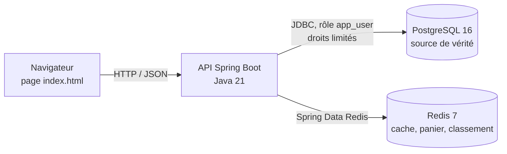
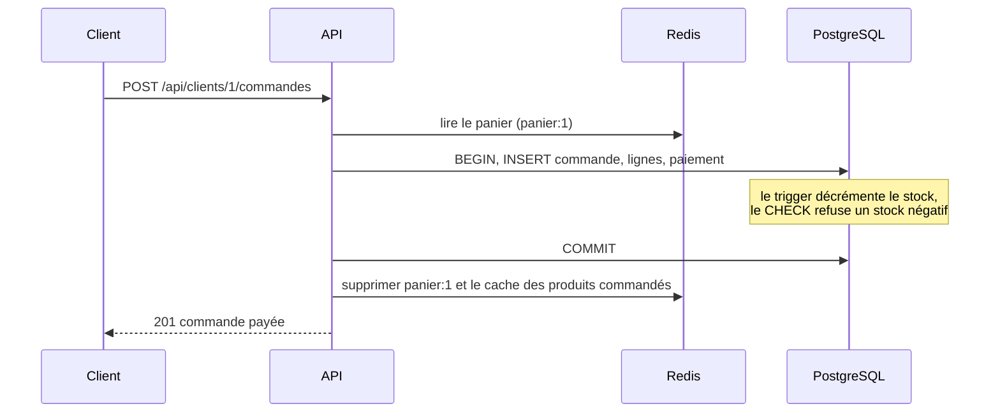
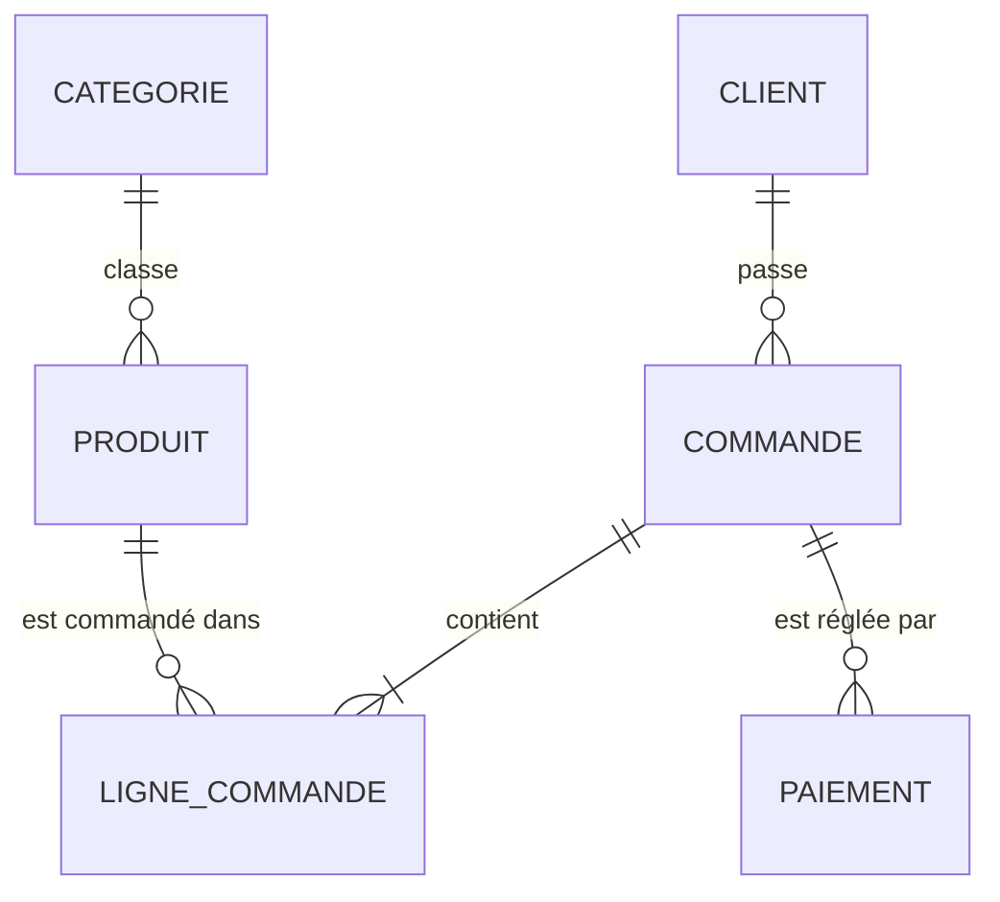

# Document de présentation : boutique en ligne PostgreSQL + Redis

Projet final « Bases de données relationnelles et non relationnelles », Mastère 1 Développement, EFREI.
Projet individuel. Auteur : Faridatou AMADOU.

## 1. Le projet

**Contexte.** Une boutique en ligne doit gérer deux types de données très différents : des données métier durables et liées entre elles (clients, produits, commandes, paiements) et des données temporaires ou très sollicitées (panier, produits consultés, détail produit relu en boucle). Le projet associe une base relationnelle et une base clé-valeur, chacune à ce qu'elle fait de mieux.

**Utilisateurs.**
- Le **client** parcourt le catalogue, consulte un produit, remplit son panier et commande.
- Le **gestionnaire du catalogue** crée, modifie et supprime des produits, et consulte le chiffre d'affaires par catégorie.

**Fonctionnalités principales.**
- Catalogue paginé et détail d'un produit (avec cache).
- Classement des produits les plus consultés.
- Panier (ajout, modification de quantité, vidage).
- Validation de commande avec paiement, dans une seule transaction.
- Statistiques de ventes par catégorie.
- Gestion des erreurs : 400 (données invalides, panier vide), 404 (ressource absente), 409 (stock insuffisant ou référence inexistante).

## 2. Architecture



Les trois composants tournent dans des conteneurs lancés par un seul `docker-compose.yml`. L'API attend que les deux bases soient « healthy » avant de démarrer.

**Flux d'une commande.** C'est le parcours qui croise les deux bases :



**Flux d'une lecture de produit (cache-aside).** L'API lit `produit:{id}` dans Redis. Si la clé existe, c'est un `HIT` et PostgreSQL n'est pas sollicité. Sinon (`MISS`), l'API lit PostgreSQL, écrit le résultat dans Redis avec une durée de vie de 5 minutes, puis répond. L'en-tête HTTP `X-Cache` indique le cas.

## 3. Modèle relationnel

### MCD



Une commande peut avoir plusieurs paiements (un paiement refusé puis un paiement accepté, par exemple), d'où la cardinalité 1-N.

### MLD

Clés primaires en gras, clés étrangères précédées de `#`.

- **categorie** (**id**, nom)
- **produit** (**id**, nom, description, prix, stock, #categorie_id)
- **client** (**id**, nom, email, date_inscription)
- **commande** (**id**, #client_id, date_commande, statut)
- **ligne_commande** (**#commande_id, #produit_id**, quantite, prix_unitaire)
- **paiement** (**id**, #commande_id, montant, methode, statut, date_paiement, reference)

`prix_unitaire` est copié dans `ligne_commande` volontairement : il conserve le prix payé, même si le prix du produit change ensuite.

### MPD (script de création commenté)

Script complet : `docker/init-sql/01-schema.sql`.

```sql
-- Les identifiants sont générés par la base (GENERATED ALWAYS AS IDENTITY).
CREATE TABLE client (
    id               BIGINT GENERATED ALWAYS AS IDENTITY PRIMARY KEY,
    nom              VARCHAR(100) NOT NULL,
    -- UNIQUE : un e-mail = un compte ; CHECK : format minimal
    email            VARCHAR(150) NOT NULL UNIQUE CHECK (email LIKE '%@%'),
    date_inscription TIMESTAMP NOT NULL DEFAULT now()
);

CREATE TABLE categorie (
    id  BIGINT GENERATED ALWAYS AS IDENTITY PRIMARY KEY,
    nom VARCHAR(80) NOT NULL UNIQUE
);

CREATE TABLE produit (
    id           BIGINT GENERATED ALWAYS AS IDENTITY PRIMARY KEY,
    nom          VARCHAR(150) NOT NULL,
    description  TEXT,
    prix         NUMERIC(10,2) NOT NULL CHECK (prix >= 0),
    -- Le CHECK sur le stock est le garde-fou final contre la survente
    stock        INTEGER NOT NULL DEFAULT 0 CHECK (stock >= 0),
    categorie_id BIGINT NOT NULL REFERENCES categorie(id)
);

CREATE TABLE commande (
    id            BIGINT GENERATED ALWAYS AS IDENTITY PRIMARY KEY,
    client_id     BIGINT NOT NULL REFERENCES client(id),
    date_commande TIMESTAMP NOT NULL DEFAULT now(),
    statut        VARCHAR(20) NOT NULL DEFAULT 'EN_ATTENTE'
        CHECK (statut IN ('EN_ATTENTE','PAYEE','EXPEDIEE','ANNULEE'))
);

CREATE TABLE ligne_commande (
    commande_id   BIGINT NOT NULL REFERENCES commande(id) ON DELETE CASCADE,
    produit_id    BIGINT NOT NULL REFERENCES produit(id),
    quantite      INTEGER NOT NULL CHECK (quantite > 0),
    prix_unitaire NUMERIC(10,2) NOT NULL CHECK (prix_unitaire >= 0),
    PRIMARY KEY (commande_id, produit_id)   -- un produit une seule fois par commande
);

CREATE TABLE paiement (
    id            BIGINT GENERATED ALWAYS AS IDENTITY PRIMARY KEY,
    commande_id   BIGINT NOT NULL REFERENCES commande(id),
    montant       NUMERIC(10,2) NOT NULL CHECK (montant > 0),
    methode       VARCHAR(20) NOT NULL
        CHECK (methode IN ('CARTE','MOBILE_MONEY','VIREMENT','ESPECES')),
    statut        VARCHAR(20) NOT NULL DEFAULT 'EN_ATTENTE'
        CHECK (statut IN ('EN_ATTENTE','VALIDE','REFUSE','REMBOURSE')),
    date_paiement TIMESTAMP NOT NULL DEFAULT now(),
    reference     VARCHAR(60) NOT NULL UNIQUE
);
```

**Vue** (`02-views-functions.sql`), lue par l'endpoint `GET /api/statistiques/categories` :

```sql
CREATE VIEW v_ventes_par_categorie AS
SELECT c.id AS categorie_id, c.nom AS categorie,
       SUM(lc.quantite) AS quantite_vendue,
       SUM(lc.quantite * lc.prix_unitaire) AS chiffre_affaires
FROM categorie c
JOIN produit p         ON p.categorie_id = c.id
JOIN ligne_commande lc ON lc.produit_id = p.id
JOIN commande cmd      ON cmd.id = lc.commande_id
WHERE cmd.statut IN ('PAYEE','EXPEDIEE')
GROUP BY c.id, c.nom;
```

**Logique serveur : trigger de stock.**

```sql
CREATE FUNCTION fn_decrementer_stock() RETURNS trigger AS $$
BEGIN
    UPDATE produit SET stock = stock - NEW.quantite WHERE id = NEW.produit_id;
    RETURN NEW;
END;
$$ LANGUAGE plpgsql;

CREATE TRIGGER trg_decrementer_stock
AFTER INSERT ON ligne_commande
FOR EACH ROW EXECUTE FUNCTION fn_decrementer_stock();
```
Si le stock devient négatif, le `CHECK (stock >= 0)` fait échouer l'insertion et toute la transaction est annulée.

**Rôle applicatif** (`03-roles.sh`). L'API ne se connecte jamais en superutilisateur : le rôle `app_user` a seulement `SELECT, INSERT, UPDATE, DELETE` sur les tables et l'usage des séquences. Il ne peut ni créer ni supprimer de tables : la commande `DROP TABLE client;` lancée avec ce rôle est refusée (`must be owner of table client`). Son mot de passe vient du fichier `.env`, jamais du dépôt.

## 4. Modèle non relationnel (Redis)

Convention de nommage : `type:identifiant`, en minuscules, séparé par deux-points.

| Clé | Structure | Contenu | Durée de vie |
|---|---|---|---|
| `produit:{id}` | hash | champs `nom`, `description`, `prix`, `stock`, `categorieId` | 5 minutes |
| `classement:produits:vues` | sorted set | membre = id du produit, score = nombre de vues | aucune |
| `panier:{clientId}` | hash | champ = id du produit, valeur = quantité | 7 jours, renouvelée à chaque modification |

**Exemple commenté.**

```
> HGETALL produit:7                          # le détail du produit 7, champ par champ
> TTL produit:7                              # secondes avant expiration (maximum 300)
> ZREVRANGE classement:produits:vues 0 4 WITHSCORES   # les 5 produits les plus consultés
> HGETALL panier:1                           # panier du client 1 : produit puis quantité
> TTL panier:1                               # proche de 604800 secondes (7 jours)
```

**Stratégie d'invalidation du cache.**
- Modification (`PUT`) ou suppression (`DELETE`) d'un produit : la clé `produit:{id}` est supprimée, la lecture suivante recharge depuis PostgreSQL.
- Commande validée : les clés `produit:{id}` des produits commandés sont supprimées, car leur stock a changé.
- Suppression d'un produit : il est aussi retiré du classement.
- Sinon, l'expiration (TTL de 5 minutes) borne l'obsolescence.

## 5. Justification des choix techniques

**Pourquoi PostgreSQL.** Les clients, produits, commandes et paiements sont liés par des relations fortes. Il faut des clés étrangères pour l'intégrité, des transactions pour qu'une commande soit enregistrée entièrement ou pas du tout, des contraintes `CHECK` pour protéger le stock et les montants, et des requêtes analytiques (jointures, agrégats, CTE). C'est exactement le terrain du modèle relationnel.

**Pourquoi Redis.** Trois besoins ne demandent ni jointure ni schéma strict, mais de la vitesse et de l'expiration :
- le détail d'un produit est relu en boucle : un cache à durée de vie évite de solliciter PostgreSQL ;
- le panier est temporaire par nature : le TTL supprime les paniers abandonnés sans aucune tâche de nettoyage ;
- le classement des consultations demande des incréments très fréquents : `ZINCRBY` sur un sorted set remplace un `UPDATE` suivi d'un `GROUP BY` sur une table.

**Répartition des données.**

| Donnée | Base | Raison |
|---|---|---|
| Clients, produits, catégories | PostgreSQL | données de référence, relations et contraintes |
| Commandes, lignes, paiements | PostgreSQL | transaction, historique durable, requêtes analytiques |
| Détail produit en cache | Redis | lecture répétée, doit expirer |
| Panier | Redis | temporaire, écriture fréquente, expiration naturelle |
| Classement des vues | Redis | incrément atomique, tri natif |

**Comment les deux bases sont reliées.**
- **Identifiants partagés** : les ids de PostgreSQL (produit, client) servent de clés dans Redis.
- **Source de vérité** : PostgreSQL. Redis ne contient que des copies ou des données jetables.
- **Cohérence** : il n'y a pas de transaction distribuée. Redis n'est modifié qu'**après** le commit de PostgreSQL (`afterCommit`) : si la transaction échoue, le panier reste intact. Les caches sont invalidés à chaque modification.

**Pourquoi pas d'autre base.** Aucune donnée du projet n'a une forme de document ni de graphe qui justifierait une troisième base ; en ajouter une serait de l'empilement de technologies.

## 6. Exemples de requêtes

Les six requêtes sont dans `docs/requetes.sql`. Les résultats sont ceux du jeu de démonstration.

**Q1. Meilleurs clients** (jointures internes, `GROUP BY`, `HAVING`). Clients dont les commandes payées ou expédiées dépassent 3 000.

```sql
SELECT c.id, c.nom, COUNT(DISTINCT cmd.id) AS nb_commandes,
       SUM(lc.quantite * lc.prix_unitaire) AS total_depense
FROM client c
JOIN commande cmd ON cmd.client_id = c.id
JOIN ligne_commande lc ON lc.commande_id = cmd.id
WHERE cmd.statut IN ('PAYEE', 'EXPEDIEE')
GROUP BY c.id, c.nom
HAVING SUM(lc.quantite * lc.prix_unitaire) > 3000
ORDER BY total_depense DESC LIMIT 10;
```
Résultat : le premier est « Client 1905 » avec 8 commandes pour 18 447,42, puis « Client 108 » (7 commandes, 16 638,88) et « Client 1576 » (6 commandes, 16 408,59).

**Q2. Clients sans commande** (jointure externe). `LEFT JOIN` puis filtre sur `cmd.id IS NULL`.

```sql
SELECT c.id, c.nom, c.date_inscription
FROM client c LEFT JOIN commande cmd ON cmd.client_id = c.id
WHERE cmd.id IS NULL
ORDER BY c.date_inscription LIMIT 10;
```
Résultat : les clients 1096, 346 et 53 sont les plus anciens inscrits sans aucun achat.

**Q3. Quantités vendues par catégorie et par statut** (agrégats avec `FILTER`). Un seul parcours des données produit plusieurs colonnes conditionnelles.

```sql
SELECT cat.nom AS categorie,
       SUM(lc.quantite) FILTER (WHERE cmd.statut = 'PAYEE')    AS payees,
       SUM(lc.quantite) FILTER (WHERE cmd.statut = 'EXPEDIEE') AS expediees,
       SUM(lc.quantite) FILTER (WHERE cmd.statut = 'ANNULEE')  AS annulees
FROM categorie cat
JOIN produit p ON p.categorie_id = cat.id
JOIN ligne_commande lc ON lc.produit_id = p.id
JOIN commande cmd ON cmd.id = lc.commande_id
GROUP BY cat.nom ORDER BY cat.nom;
```
Résultat : par exemple « Jouets » 2 279 payées, 3 120 expédiées, 979 annulées ; « Maison » 2 229, 3 218 et 1 103.

**Q4. Chiffre d'affaires mensuel et évolution** (CTE `WITH` et fonction de fenêtre `LAG`).

```sql
WITH ca_mensuel AS (
    SELECT date_trunc('month', cmd.date_commande) AS mois,
           SUM(lc.quantite * lc.prix_unitaire) AS ca
    FROM commande cmd JOIN ligne_commande lc ON lc.commande_id = cmd.id
    WHERE cmd.statut IN ('PAYEE', 'EXPEDIEE')
    GROUP BY 1
)
SELECT to_char(mois, 'YYYY-MM') AS mois, round(ca, 2) AS ca,
       round(100 * (ca - LAG(ca) OVER (ORDER BY mois)) / LAG(ca) OVER (ORDER BY mois), 1) AS evolution_pct
FROM ca_mensuel ORDER BY mois;
```
Résultat : de 482 814,12 en novembre 2025 à 598 939,29 en décembre (+24,1 %), puis un CA mensuel entre environ 520 000 et 620 000. Le premier mois (octobre 2025, 55 303,67) est **incomplet**, car les commandes générées couvrent un an glissant : le +773 % de novembre est un artefact du jeu de données, pas une réalité commerciale.

**Q5. Clients ayant une commande annulée et une commande expédiée** (`EXISTS`).

```sql
SELECT c.id, c.nom FROM client c
WHERE EXISTS (SELECT 1 FROM commande x WHERE x.client_id = c.id AND x.statut = 'ANNULEE')
  AND EXISTS (SELECT 1 FROM commande y WHERE y.client_id = c.id AND y.statut = 'EXPEDIEE')
ORDER BY c.id LIMIT 10;
```
Résultat : les clients 5, 9, 17, 21, 25, etc. `EXISTS` s'arrête dès qu'une ligne correspond, sans compter toutes les commandes.

**Q6. Produits plus chers que la moyenne de leur catégorie** (sous-requête corrélée).

```sql
SELECT p.id, p.nom, cat.nom AS categorie, p.prix
FROM produit p JOIN categorie cat ON cat.id = p.categorie_id
WHERE p.prix > (SELECT AVG(p2.prix) FROM produit p2 WHERE p2.categorie_id = p.categorie_id)
ORDER BY p.prix DESC LIMIT 10;
```
Résultat : en tête, le produit 391 (Alimentation, 499,49), le produit 37 (Beauté, 498,90) et le produit 359 (Alimentation, 498,10).

## 7. Index et performance

**Situation.** La clé primaire de `ligne_commande` est `(commande_id, produit_id)`. Elle accélère les recherches par commande, mais pas celles par `produit_id` seul, qui sont fréquentes (ventes d'un produit, statistiques par catégorie). Sans index, PostgreSQL lit toute la table.

**Mesure** de `SELECT * FROM ligne_commande WHERE produit_id = 42;` sur 12 500 lignes (`EXPLAIN (ANALYZE, BUFFERS)`).

| | Sans index | Avec `idx_ligne_commande_produit` |
|---|---|---|
| Plan | `Seq Scan` | `Bitmap Index Scan` puis `Bitmap Heap Scan` |
| Lignes lues puis écartées | 12 462 | 0 |
| Pages lues | 92 | environ 47 |
| Temps d'exécution | **33,1 ms** | **0,158 ms** |

Extrait avant : `Seq Scan on ligne_commande ... Rows Removed by Filter: 12462 ... Execution Time: 33.100 ms`.
Extrait après : `Bitmap Index Scan on idx_ligne_commande_produit ... Execution Time: 0.158 ms`.

**Réserve.** La mesure « avant » a été faite à froid (`read=91`) : une partie des 33 ms vient de la lecture disque. Le script `docs/mesures-index.sql` refait la comparaison en mesurant chaque cas deux fois, la seconde étant à chaud. Le gain réel reste très net, mais moins spectaculaire que le rapport brut.

L'index est créé automatiquement au démarrage par `docker/init-sql/05-index.sql`.

## 8. Stratégie de sauvegarde

**Ce qui est sauvegardé.**
- **PostgreSQL**, source de vérité : export complet avec `pg_dump` au format custom (`-Fc`), fréquence recommandée **quotidienne**.
- **Redis** : snapshot RDB par la commande `SAVE`, fréquence recommandée **horaire**. Seuls les paniers (7 jours) sont réellement perdus en cas d'incident ; le cache et le classement se reconstruisent à l'usage.

**Comment.** `scripts/backup.ps1` produit les deux fichiers horodatés dans `backups/` (dossier ignoré par git, car il contient des données).

**Comment on restaure.**
- **PostgreSQL** : `.\scripts\restore.ps1 backups\boutique-AAAAMMJJ-HHMMSS.dump`. Procédure **testée** : après un `TRUNCATE` simulant un sinistre, `ligne_commande` est passée de 12 502 à 0 puis est revenue à 12 502 lignes.
- **Redis** : arrêter le conteneur, remplacer `/data/dump.rdb` du volume par le fichier sauvegardé, redémarrer. Cette procédure n'a **pas été testée** dans ce projet.

**Limites.** Les sauvegardes restent sur la même machine, et leur planification (Planificateur de tâches Windows ou `cron`) n'est pas automatisée : les fréquences ci-dessus sont une politique recommandée, exécutée à la main.

## 9. Limites et pistes d'amélioration

**Limites.**
- Le paiement est **simulé** : il est enregistré comme validé immédiatement, sans passerelle de paiement.
- Il n'y a **pas d'authentification** : n'importe qui peut agir sur le panier de n'importe quel client.
- Pas de transaction distribuée entre PostgreSQL et Redis : si Redis est indisponible juste après le commit, le panier peut subsister alors que la commande est enregistrée.
- Le classement des vues n'expire jamais et grossit avec le catalogue.
- Aucun test automatisé : la validation s'est faite par scénarios exécutés à la main.
- Les mots de passe du dépôt sont des valeurs de démonstration.
- Les données de démonstration sont aléatoires (les statistiques n'ont pas de sens commercial).

**Pistes d'amélioration.**
- Authentification et autorisation (JWT), HTTPS.
- Une vraie passerelle de paiement avec statuts asynchrones.
- Tests automatisés avec Testcontainers.
- Sauvegardes planifiées, copiées hors de la machine, et Redis en mode AOF.
- Index supplémentaires, par exemple sur `commande(client_id)`, mesurés comme l'index existant.
- Réplication PostgreSQL pour la haute disponibilité.